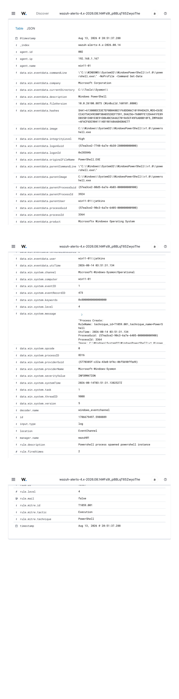
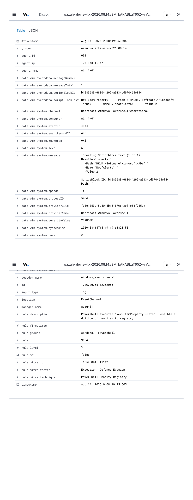

# Windows Endpoint Telemetry

## Overview

After getting Wazuh running and enrolling a Linux endpoint, I wanted to add Windows monitoring to the homelab.

I created a Windows 11 Pro virtual machine and configured it to send security events to Wazuh.

The initial goal was to get the Windows agent working. I then added Sysmon and PowerShell Script Block Logging to collect more detailed information about process execution, scripts, and changes to the system.

I also wanted to generate some controlled activity and see whether the resulting events made it all the way into the SIEM.

The work described here began when the Windows VM was a standalone workstation. The system was subsequently joined to the `corp.home.arpa` Active Directory domain.

---

## 1. Lab Configuration

| System | Address | Role |
|---|---|---|
| `win11-01` | `10.10.30.160` | Windows 11 Pro endpoint |
| `wazuh01` | `10.10.40.20` | Wazuh SIEM |
| `dns01` | `192.168.1.20` | Pi-hole DNS |
| `dc01` | `10.10.20.10` | Active Directory domain controller |

`win11-01` runs as a Proxmox virtual machine.

It uses VLAN 30 for the USERS network, while `wazuh01` uses VLAN 40 for security monitoring.

OPNsense routes the permitted Wazuh agent traffic between those VLANs.

---

## 2. Proxmox Guest Integration

I installed the Windows VirtIO drivers and QEMU Guest Agent to improve integration between the Windows VM and Proxmox.

The guest agent installer was included on the VirtIO driver ISO.

After installation, I checked the Windows service:

```powershell
Get-Service QEMU-GA
```

With the guest agent running, Proxmox was able to report the Windows guest's IPv4 address and other information.

This gave me another way to check the VM's operating state from the hypervisor.

---

## 3. Installing the Wazuh Agent

I configured the Windows Wazuh agent to use `wazuh01` (`10.10.40.20`) as its manager.

The installation didn't work on my first attempt.

### Diagnosing the Installation Failure

I checked whether the service had been created:

```powershell
Get-Service *wazuh*
```

Then checked the expected installation directory:

```powershell
Test-Path "C:\Program Files (x86)\ossec-agent"
```

The directory check returned:

```text
False
```

The Wazuh service was also missing.

That established that the problem wasn't simply a stopped service. The agent hadn't actually been installed.

After reinstalling the MSI, the Windows service appeared.

I then encountered a permissions problem when trying to control the service from PowerShell. Reopening PowerShell as Administrator resolved that issue.

### Verifying the Agent

I checked the service:

```powershell
Get-Service WazuhSvc
```

Then tested connectivity to the manager:

```powershell
Test-NetConnection 10.10.40.20 -Port 1514
```

The result included:

```text
TcpTestSucceeded : True
```

Finally, I checked the Wazuh dashboard and confirmed that `win11-01` appeared as an active agent.

These were separate checks: installation, service state, TCP connectivity, and successful SIEM enrollment.

A successful connection to port 1514 alone wouldn't have established that the endpoint was actively sending useful events.

---

## 4. Installing Sysmon

Windows already records many useful events, but I wanted more detailed information about processes and system activity.

For that, I installed Sysmon from Microsoft's Sysinternals tools.

I created a working directory:

```powershell
New-Item -ItemType Directory -Path C:\Tools\Sysmon -Force
cd C:\Tools\Sysmon
```

After downloading and extracting Sysmon, I installed it with an XML configuration:

```powershell
.\Sysmon64.exe -accepteula -i .\sysmonconfig.xml
```

I checked the service:

```powershell
Get-Service *sysmon*
```

And inspected recent events:

```powershell
Get-WinEvent -LogName "Microsoft-Windows-Sysmon/Operational" -MaxEvents 5
```

The Sysmon Operational log was producing events.

---

## 5. Sending Sysmon Events to Wazuh

The next step was to have the Windows Wazuh agent collect the Sysmon event channel.

Before changing the configuration, I backed up the agent's existing `ossec.conf` file:

```powershell
Copy-Item "C:\Program Files (x86)\ossec-agent\ossec.conf" `
          "C:\Program Files (x86)\ossec-agent\ossec.conf.pre-sysmon"
```

I then added the Sysmon event channel to the Wazuh agent configuration:

```xml
<localfile>
  <location>Microsoft-Windows-Sysmon/Operational</location>
  <log_format>eventchannel</log_format>
</localfile>
```

After editing the configuration, I restarted the Wazuh service:

```powershell
Restart-Service WazuhSvc
```

This allowed the agent to forward Sysmon events to the Wazuh manager for analysis.

---

## 6. Testing PowerShell Process Detection

To generate a straightforward process event, I executed:

```powershell
powershell.exe -NoProfile -Command "Get-Date"
```

Sysmon recorded the process execution as Event ID 1.

Wazuh generated an alert:

| Field | Value |
|---|---|
| Rule ID | `92027` |
| Level | 4 |
| Description | Powershell process spawned powershell instance |
| MITRE ATT&CK | `T1059.001` — PowerShell |

The alert included useful details such as the process image, command line, parent process, user context, integrity level, process identifiers, and executable hashes.

The event demonstrated that Windows process activity was being recorded locally and received by Wazuh.



---

## 7. Enabling PowerShell Script Block Logging

Sysmon provided process execution information, but I also wanted visibility into the PowerShell commands and scripts being executed.

I enabled PowerShell Script Block Logging through Local Group Policy.

The setting is located at:

```text
Computer Configuration
  → Administrative Templates
  → Windows Components
  → Windows PowerShell
  → Turn on PowerShell Script Block Logging
```

I checked the resulting policy configuration:

```powershell
Get-ItemProperty `
  "HKLM:\SOFTWARE\Policies\Microsoft\Windows\PowerShell\ScriptBlockLogging"
```

The important value was:

```text
EnableScriptBlockLogging : 1
```

Script Block Logging records events in the Windows PowerShell Operational event channel, including Event ID 4104.

### Wazuh Event Collection

I configured the Wazuh agent to collect that event channel:

```xml
<localfile>
  <location>Microsoft-Windows-PowerShell/Operational</location>
  <log_format>eventchannel</log_format>
</localfile>
```

This added PowerShell script telemetry to the existing Windows endpoint monitoring.

---

## 8. Testing a Registry Modification

For the next exercise, I wanted to generate a PowerShell command that changed the registry and check whether the activity would produce a Wazuh alert.

I used:

```powershell
New-ItemProperty `
  -Path "HKLM:\Software\Microsoft\ADs" `
  -Name "NoofAlerts" `
  -Value 2
```

The command created a registry value.

Windows recorded the PowerShell activity as Event ID 4104.

I checked the local events with:

```powershell
Get-WinEvent -FilterHashtable @{
    LogName='Microsoft-Windows-PowerShell/Operational'
    Id=4104
} -MaxEvents 10
```

Wazuh generated:

| Field | Value |
|---|---|
| Rule ID | `91843` |
| Level | 3 |
| Description | Powershell executed `New-ItemProperty -Path`; possible registry item addition |
| MITRE ATT&CK | `T1059.001`, `T1112` |

The activity mapped to PowerShell execution and registry modification.

This was a controlled test, not an actual attack, but it demonstrated how the telemetry and detection rules behaved.



### Removing the Test Value

After verifying the event, I removed the registry value:

```powershell
Remove-ItemProperty `
  -Path "HKLM:\Software\Microsoft\ADs" `
  -Name "NoofAlerts"
```

That returned the test location to its prior state.

---

## 9. Following the Telemetry

The Windows experiments established a working event pipeline:

```text
Windows activity
        |
        v
Sysmon / PowerShell event logs
        |
        v
Wazuh agent on win11-01
        |
        v
Wazuh manager — wazuh01
        |
        v
Wazuh detection rules
        |
        v
Security alert
        |
        v
Threat Hunting investigation
```

I checked both the local Windows events and the resulting Wazuh alerts.

That distinction is important because it demonstrates more than just the fact that the endpoint agent was connected.

It shows that the intended activity was recorded, forwarded, interpreted, and available for investigation.

---

## 10. Active Directory Integration

The Windows endpoint was initially configured with a local administrator account.

I subsequently deployed Windows Server 2025 Active Directory and joined `win11-01` to the `corp.home.arpa` domain.

That expanded the kinds of events I could monitor to include domain logon and account-management activity.

The Active Directory deployment and its Wazuh detection exercises are documented separately.

[Active Directory Lab](10-active-directory-lab.md)

---

## 11. Result

The Windows endpoint successfully generated security telemetry through Sysmon and PowerShell Script Block Logging.

Wazuh detected the controlled PowerShell process execution and registry modification, using rules `92027` and `91843`.

The work included some practical troubleshooting along the way, particularly determining why the Wazuh agent hadn't installed and identifying the permissions needed to manage its Windows service.

The endpoint is now part of the broader Windows and Active Directory monitoring environment.

Additional exercises involving account management and security events are documented in the Wazuh detection labs and Active Directory documentation.

## Related Documentation

- [Wazuh SIEM Deployment](06-wazuh-siem.md)
- [Wazuh Attack Detection Labs](09-attack-detection-labs.md)
- [Active Directory Lab](10-active-directory-lab.md)
- [SOC Alert Triage Playbook](12-soc-alert-triage-playbook.md)
