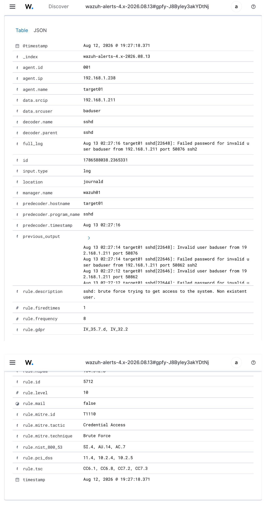
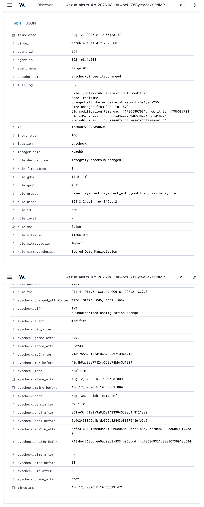
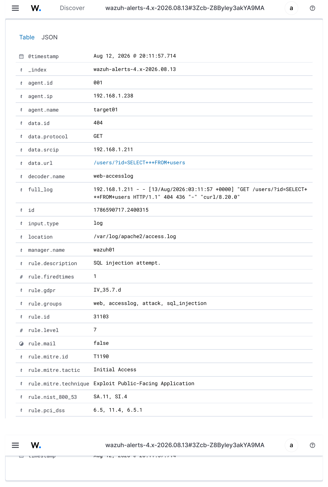
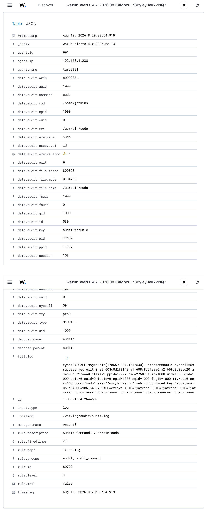
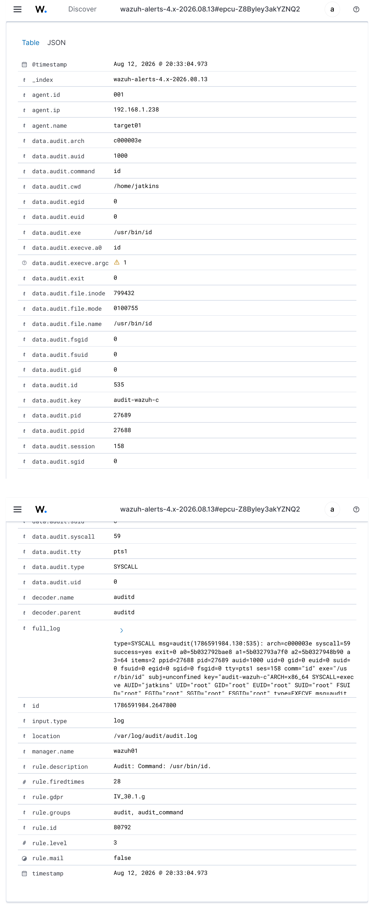
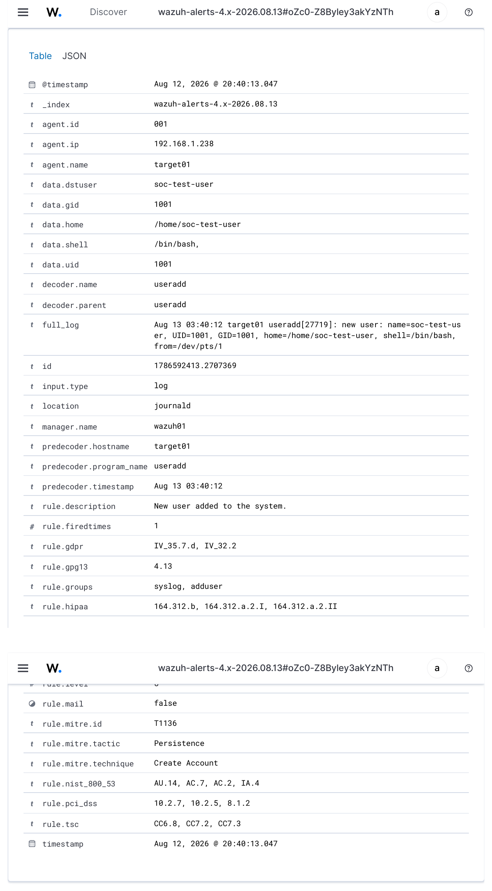
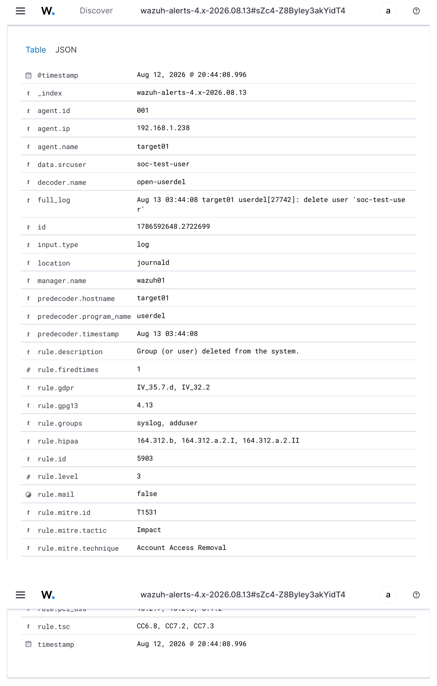

# Wazuh Attack Detection Labs

## Overview

After getting Wazuh running and enrolling Linux and Windows endpoints, I wanted to see what kinds of security events I could actually detect.

Having a SIEM dashboard and connected agents was only the beginning. I needed to generate known activity, verify that the endpoints recorded it, and see what Wazuh made of the resulting logs.

I started with SSH authentication failures, file changes, and suspicious web requests. I then added Linux Auditd, account-management events, Sysmon, and PowerShell Script Block Logging.

The exercises are controlled tests against my own lab systems.

For each test, I tried to answer three questions:

1. Did the activity occur and get recorded on the endpoint?
2. Did Wazuh collect and identify the event?
3. Did the alert provide enough information to investigate what happened?

---

## Lab Environment

| System | Address | Role |
|---|---|---|
| `wazuh01` | `10.10.40.20` | Wazuh SIEM |
| `target01` | `10.10.60.10` | Ubuntu monitored endpoint |
| `kali01` | `10.10.50.113` | Security-testing system |
| `win11-01` | `10.10.30.160` | Windows monitored endpoint |

`target01` was enrolled as Wazuh agent `001`.

The Windows endpoint was subsequently added to provide process and PowerShell telemetry.

---

## Lab 1 — SSH Brute-Force Detection

### Test

I generated repeated failed SSH login attempts from `kali01` against a nonexistent account named `baduser` on `target01`.

The test produced eight failed authentication attempts in rapid succession.

### Endpoint Evidence

On `target01`, I examined the SSH journal:

```bash
sudo journalctl -u ssh --no-pager | grep '10.10.50.113'
```

The recorded events included:

```text
Failed password for invalid user baduser from 10.10.50.113
```

There were eleven failed-password records in the journal, including earlier testing. The Wazuh correlation event represented the eight new attempts.

### Wazuh Detection

| Field | Value |
|---|---|
| Rule | `5712` |
| Level | 10 |
| Description | SSH brute force against nonexistent user |
| Source | `10.10.50.113` |
| Target | `target01` |
| Frequency | 8 |
| MITRE ATT&CK | `T1110` — Brute Force |



### Investigation

I compared the Wazuh alert with the SSH journal to confirm the source address, account name, and failure count.

In a real investigation, I would also look for successful authentication after the failures, activity from the same source against other accounts, and any related events elsewhere in the environment.

The important result was that Wazuh correlated individual authentication failures into a higher-level alert.

---

## Lab 2 — File Integrity Monitoring

### Test

I configured Wazuh File Integrity Monitoring to watch a dedicated test directory on `target01`.

First, I created the directory:

```bash
sudo mkdir -p /opt/wazuh-lab
```

I added it to the Wazuh agent's `syscheck` configuration:

```xml
<directories check_all="yes" realtime="yes" report_changes="yes">/opt/wazuh-lab</directories>
```

Then restarted the agent:

```bash
sudo systemctl restart wazuh-agent
sudo systemctl is-active wazuh-agent
```

### Generating File Changes

I created a configuration file:

```bash
echo "original configuration" | sudo tee /opt/wazuh-lab/test.conf
```

Then modified it:

```bash
echo "unauthorized configuration change" | \
sudo tee -a /opt/wazuh-lab/test.conf
```

The file was subsequently removed as part of the test.

### Wazuh Detection

| Field | Value |
|---|---|
| Rule | `550` |
| Level | 7 |
| Event | File modification |
| Mode | Real-time |
| MITRE ATT&CK | `T1565.001` — Stored Data Manipulation |

Wazuh recorded changes to the file size, modification time, and MD5, SHA-1, and SHA-256 hashes.

The reported file size changed from 23 bytes to 57 bytes.

Because `report_changes="yes"` was enabled, the alert also included the added text:

```text
> unauthorized configuration change
```



### Investigation

The alert identified the modified file and showed what changed.

The hashes provided before-and-after integrity evidence, while the text difference showed the actual modification.

This would be useful for monitoring configuration files, scripts, or application settings where unexpected changes could indicate a problem.

---

## Lab 3 — SQL-Injection-Style Web Request

### Test

I wanted to see whether Wazuh would identify a suspicious HTTP request from an Apache access log.

On `target01`, I configured the Wazuh agent to collect:

```xml
<localfile>
  <log_format>apache</log_format>
  <location>/var/log/apache2/access.log</location>
</localfile>
```

After restarting the agent, I sent a test request from `kali01`:

```bash
curl -XGET "http://10.10.60.10/users/?id=SELECT+*+FROM+users"
```

The URL contained SQL-like syntax.

There was no vulnerable application at that path, and Apache returned HTTP 404.

The purpose was to generate a recognizable access-log entry, not exploit a web application.

### Wazuh Detection

| Field | Value |
|---|---|
| Rule | `31103` |
| Level | 7 |
| Description | SQL injection attempt |
| Source | `10.10.50.113` |
| HTTP method | GET |
| HTTP response | 404 |
| MITRE ATT&CK | `T1190` — Exploit Public-Facing Application |

The alert preserved the suspicious request path:

```text
/users/?id=SELECT+*+FROM+users
```



### Investigation

Wazuh recognized suspicious request syntax, even though Apache returned 404.

This demonstrated detection of a possible attack attempt, **not successful SQL injection or exploitation**.

A fuller investigation would examine related HTTP requests, the application's behavior, other log sources, and whether any subsequent activity suggested that an attack succeeded.

---

## Lab 4 — Privileged Command Monitoring with Auditd

### Test

I wanted to identify commands running with root privileges while retaining the identity of the user who started them.

I used Linux Auditd on `target01`.

First, I checked its state:

```bash
sudo auditctl -s
```

Auditing was enabled, and no lost events were reported.

### Wazuh Audit Log Collection

I configured the Wazuh agent to collect Auditd events:

```xml
<localfile>
  <log_format>audit</log_format>
  <location>/var/log/audit/audit.log</location>
</localfile>
```

### Audit Rules

I added rules to monitor `execve` system calls with effective UID 0:

```bash
echo '-a exit,always -F euid=0 -F arch=b64 -S execve -k audit-wazuh-c' | \
sudo tee -a /etc/audit/audit.rules
```

```bash
echo '-a exit,always -F euid=0 -F arch=b32 -S execve -k audit-wazuh-c' | \
sudo tee -a /etc/audit/audit.rules
```

I loaded and checked the rules:

```bash
sudo auditctl -R /etc/audit/audit.rules
sudo auditctl -l | grep audit-wazuh-c
```

### Generating Activity

I executed:

```bash
sudo id
```

### Wazuh Detection

Wazuh generated Rule `80792`, Level 3, in the `audit_command` group.

The related events recorded both the `sudo` execution and the elevated `id` command.

The important identity fields included:

```text
AUID: 1000
EUID: 0
```

The audit records identified the original logged-in user and showed that the command executed with root privileges.





### Understanding AUID and EUID

The **AUID** (Audit User ID) identifies the original login identity associated with the session.

The **EUID** (Effective User ID) identifies the privileges under which the process executes.

For this test:

```text
Original user: jatkins
AUID:          1000

Execution:     root
EUID:          0
```

This makes it possible to distinguish the person or session responsible for an action from the privileges used to execute it.

That is useful when investigating administrative activity, especially when commands involve `sudo`.

---

## Lab 5 — Linux Account Creation and Deletion

### Creating a Test Account

I created a local user on `target01`:

```bash
sudo useradd -m -s /bin/bash soc-test-user
```

Then checked the account:

```bash
id soc-test-user
```

The account was assigned UID 1001, GID 1001, and a home directory at `/home/soc-test-user`.

### Account-Creation Detection

Wazuh processed the `useradd` event from journald.

| Field | Value |
|---|---|
| Rule | `5902` |
| Level | 8 |
| Description | New user added to the system |
| Decoder | `useradd` |
| MITRE ATT&CK | `T1136` — Create Account |



Creating a local account can be ordinary administration, but unexpected account creation can also indicate persistence.

I would want to know who created the account, whether the change was authorized, which groups it belonged to, and whether the account subsequently authenticated.

### Account Deletion

After validating the creation alert, I removed the test account:

```bash
sudo userdel -r soc-test-user
```

Wazuh generated a second alert.

| Field | Value |
|---|---|
| Rule | `5903` |
| Level | 3 |
| Description | Group or user deleted |
| Decoder | `open-userdel` |
| MITRE ATT&CK | `T1531` — Account Access Removal |



Together, the two detections demonstrated that Wazuh could monitor both creation and deletion of a local Linux account.

---

## Lab 6 — Windows Sysmon PowerShell Detection

### Test

After enrolling `win11-01`, I installed Sysmon to collect more detailed Windows process telemetry.

I generated a straightforward PowerShell execution:

```powershell
powershell.exe -NoProfile -Command "Get-Date"
```

Sysmon recorded the execution in:

```text
Microsoft-Windows-Sysmon/Operational
Event ID: 1 — Process Create
```

### Wazuh Detection

| Field | Value |
|---|---|
| Rule | `92027` |
| Level | 4 |
| Description | Powershell process spawned powershell instance |
| MITRE ATT&CK | `T1059.001` — PowerShell |

The alert included the executable, command line, parent process, user, integrity level, process identifiers, and hashes.


### Investigation

The value of the event was the process context.

It showed not only that PowerShell was executed, but also how it was invoked and which process started it.

The command itself was harmless, but the same telemetry can be useful when investigating unexpected PowerShell activity.

---

## Lab 7 — PowerShell Script Block and Registry Modification

### Test

For this exercise, I enabled PowerShell Script Block Logging on `win11-01`.

I verified the policy state:

```powershell
Get-ItemProperty `
  "HKLM:\SOFTWARE\Policies\Microsoft\Windows\PowerShell\ScriptBlockLogging"
```

The output included:

```text
EnableScriptBlockLogging : 1
```

I configured the Wazuh agent to collect the PowerShell Operational channel using the `eventchannel` log format.

### Generating a Registry Change

I ran:

```powershell
New-ItemProperty `
  -Path "HKLM:\Software\Microsoft\ADs" `
  -Name "NoofAlerts" `
  -Value 2
```

Windows recorded the command as Event ID 4104, including the script block.

### Wazuh Detection

| Field | Value |
|---|---|
| Rule | `91843` |
| Level | 3 |
| Description | PowerShell registry-item addition |
| MITRE ATT&CK | `T1059.001`, `T1112` |


Script Block Logging provided visibility into the command itself rather than only identifying a PowerShell process.

After verifying the alert, I removed the test value:

```powershell
Remove-ItemProperty `
  -Path "HKLM:\Software\Microsoft\ADs" `
  -Name "NoofAlerts"
```

---

## Detection Summary

| Lab | Detection | Rule | Level | MITRE |
|---|---|---:|---:|---|
| 1 | SSH brute force | `5712` | 10 | `T1110` |
| 2 | File modification | `550` | 7 | `T1565.001` |
| 3 | SQL-injection-style request | `31103` | 7 | `T1190` |
| 4 | Privileged command | `80792` | 3 | — |
| 5a | Local account creation | `5902` | 8 | `T1136` |
| 5b | Local account deletion | `5903` | 3 | `T1531` |
| 6 | Windows PowerShell process | `92027` | 4 | `T1059.001` |
| 7 | PowerShell registry change | `91843` | 3 | `T1059.001`, `T1112` |

These are the rule IDs and levels recorded during the exercises. Detection results can differ with Wazuh versions and rule configurations.

---

## Investigation Approach

Across the exercises, I followed roughly the same process.

1. Generate a known event.
2. Verify the activity in the original endpoint or application logs.
3. Find the resulting Wazuh alert.
4. Examine the raw event and associated metadata.
5. Identify the source, target, and behavior.
6. Review the rule, severity, and MITRE ATT&CK mapping.
7. Compare the alert with the original evidence.
8. Determine what else would need investigation outside a controlled test.

This approach helped me distinguish between an event being generated, an event being collected, and an event being correctly interpreted.

The Wazuh rule provides a starting point for investigation. It doesn't automatically establish intent or prove compromise.

---

## Result

The completed exercises demonstrated working detection and analysis across several telemetry sources:

- SSH and Linux journald
- Wazuh File Integrity Monitoring
- Apache access logs
- Linux Auditd
- Linux account-management events
- Windows Sysmon
- PowerShell Script Block Logging

I was able to generate activity, verify it locally, find the corresponding Wazuh event, and review the relevant alert information.

This provided a foundation for more structured SOC investigations rather than simply using Wazuh as a dashboard.

## Future Exercises

I plan to expand the testing to include SSH `authorized_keys` changes, additional persistence techniques, custom Wazuh rules, Active Response, and alert tuning.

The Active Directory environment also provides opportunities for identity-related detections, some of which I've already tested and documented separately.

## Related Documentation

- [Wazuh SIEM Deployment](06-wazuh-siem.md)
- [Windows Endpoint Telemetry](08-windows-telemetry.md)
- [Active Directory Lab](10-active-directory-lab.md)
- [SOC Alert Triage Playbook](12-soc-alert-triage-playbook.md)
